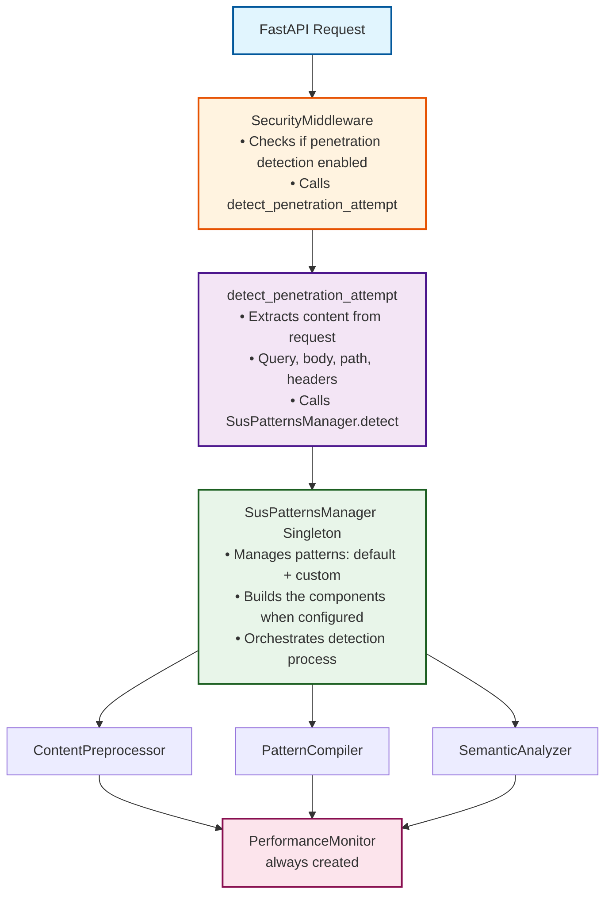
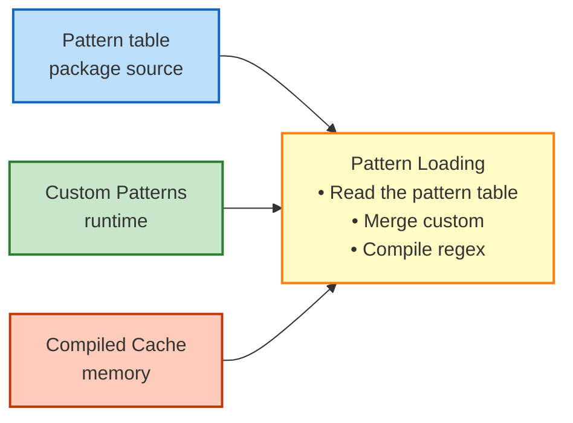

# Detection Engine Architecture

The FastAPI Guard Detection Engine uses a modular architecture that provides timeout-protected pattern matching with optional preprocessing and heuristic analysis. This document describes the actual implementation and how components interact.

## System Architecture



## Core Components

### 1. SusPatternsManager

The central component that manages the detection process:

```python
class SusPatternsManager:
    """Singleton pattern manager with enhanced detection capabilities."""

    _instance: SusPatternsManager | None = None
    _lock: threading.Lock = threading.Lock()

    def __new__(cls) -> SusPatternsManager:
        # Singleton implementation

        ...

    def __init__(self) -> None:
        # Load patterns from YAML files
        self.patterns: list[str] = []
        self.custom_patterns: set[str] = set()
        self.compiled_patterns: list[re.Pattern] = []

        # Detection engine components (built when the manager is configured)
        self._compiler: PatternCompiler | None = None
        self._preprocessor: ContentPreprocessor | None = None
        self._semantic_analyzer: SemanticAnalyzer | None = None
        self._performance_monitor: PerformanceMonitor | None = None
```

**Key Responsibilities:**

- Pattern loading from the built-in pattern table
- Custom pattern management
- Component initialization from the configuration
- Detection orchestration
- Result aggregation

### 2. Component Initialization

The components are built together when the pattern manager is configured with a `SecurityConfig`:

```python
def _build_enhanced_detection_state(config, redaction_names=None):
    return _DetectionState(
        compiler=PatternCompiler(
            default_timeout=config.detection_compiler_timeout,
            max_cache_size=config.detection_max_tracked_patterns,
            # ...
        ),
        preprocessor=ContentPreprocessor(
            max_content_length=config.detection_max_content_length,
            preserve_attack_patterns=config.detection_preserve_attack_patterns,
            # ...
        ),
        semantic_analyzer=SemanticAnalyzer(),
        performance_monitor=PerformanceMonitor(
            anomaly_threshold=config.detection_anomaly_threshold,
            slow_pattern_threshold=config.detection_slow_pattern_threshold,
            history_size=config.detection_monitor_history_size,
            max_tracked_patterns=config.detection_max_tracked_patterns,
            # ...
        ),
        semantic_threshold=config.detection_semantic_threshold,
        threat_score_threshold=config.detection_threat_score_threshold,
    )
```

This function lives in `guard_core.handlers._suspatterns_state`. All four components are always created.

## Detection Flow

### 1. Request Reception

```python
# In SuspiciousActivityCheck (guard_core.core.checks.implementations.suspicious_activity)
if self.config.enable_penetration_detection:
    result = detect_penetration_attempt(request, self.config, route_config)
    if result.is_threat:
        # Handle detected attack
        # result.trigger_info       -> human-readable trigger
        # result.threat_categories  -> e.g. ["sqli", "xss"]
        # result.threat_scores      -> {"sqli": 0.92, ...}

        ...
```

### 2. Content Extraction

```python
# In guard_core._utils.penetration_detection
def detect_penetration_attempt(
    request: GuardRequest,
    config: SecurityConfig | None = None,
    route_config: RouteConfig | None = None,
) -> DetectionResult:
    # Extract content from the request: query parameters, the request body
    # (JSON values are walked key by key), the path and the headers, each
    # tagged with its context ("query_param:<name>", "body", "path", "header:<name>"),
    # honouring excluded_detection_params, excluded_detection_headers,
    # excluded_detection_body_fields and the scan budgets
    # (detection_max_scan_values, detection_max_json_depth, detection_max_scan_chars)
    ...
```

### 3. Detection Process

```python
def scan(contents_to_check, patterns_manager, client_ip, correlation_id):
    # For each content piece
    for content, context in contents_to_check:
        result = patterns_manager.detect(
            content=content,
            ip_address=client_ip,
            context=context,
            correlation_id=correlation_id,
        )

        if result["is_threat"]:
            return _build_detection_hit(format_trigger_info(result), result["threats"])
```

### 4. Detection Implementation

A simplified sketch of `SusPatternsManager.detect()` (the real flow is in `guard_core.handlers._suspatterns_enhanced` and `suspatterns_handler`):

```python
def detect(
    self,
    content: str,
    ip_address: str,
    context: str = "unknown",
    correlation_id: str | None = None,
    **options,
) -> dict:
    start_time = time.time()
    threats = []
    timeouts = []

    # 1. Preprocess content: normalize, decode, truncate
    processed_content, decode_budget_exhausted, decoded = self._preprocess_content(
        content, correlation_id
    )

    # 2. Pattern matching: each pattern runs through the PatternCompiler's
    #    timeout-protected matchers
    #    -> threats.append({"type": "regex", "pattern": ..., "match": ...,
    #                       "position": ..., "execution_time": ...,
    #                       "category": ..., "weight": ...})
    #    -> a pattern that exceeds its time budget is added to `timeouts`

    # 3. Semantic analysis (skipped for binary content)
    semantic_threats, semantic_score = self._check_semantic_threats(processed_content)
    #    -> {"type": "semantic", "attack_type": ..., "probability": ...,
    #        "analysis": ...}, added when the score is above
    #       detection_semantic_threshold
    threats.extend(semantic_threats)

    # 4. Performance tracking: every executed pattern is recorded with
    #    performance_monitor.record_metric(pattern, execution_time,
    #                                      content_length, matched, timeout)

    # 5. Build result
    return {
        "is_threat": len(threats) > 0,
        "threat_score": threat_score,  # 0.0-1.0
        "threats": threats,
        "context": context,
        "original_length": len(content),
        "processed_length": len(processed_content),
        "execution_time": time.time() - start_time,
        "detection_method": "enhanced",
        "timeouts": timeouts,
        "correlation_id": correlation_id,
    }
```

## Data Flow

### Pattern Loading



### Detection Result Structure

```python
{
    "is_threat": bool,  # True if any threat detected
    "threat_score": float,  # 0.0-1.0, highest score
    "threats": [  # List of detected threats
        {
            "type": "regex",  # or "semantic"
            "pattern": str,  # For regex matches
            "match": str,  # The matched text (regex)
            "position": int,  # Offset of the match (regex)
            "execution_time": float,  # Pattern execution time (regex)
            "category": str,  # e.g. "sqli", "xss" (regex)
            "weight": float,  # The pattern's weight (regex)
            "attack_type": str,  # For semantic matches
            "probability": float,  # For semantic matches
        }
    ],
    "context": str,  # Where content came from
    "original_length": int,  # Original content length
    "processed_length": int,  # After preprocessing
    "execution_time": float,  # Total detection time
    "detection_method": str,  # "enhanced", or "legacy" for an unconfigured manager
    "timeouts": list[str],  # Patterns that timed out
    "correlation_id": str | None,  # Request correlation ID
}
```

## Integration Points

### 1. Configuration Integration

The engine reads configuration from `SecurityConfig`:

```python
# Key configuration fields
config.enable_penetration_detection  # Enable/disable
config.detection_compiler_timeout  # Pattern timeout
config.detection_max_content_length  # Content limit
config.detection_preserve_attack_patterns  # Preservation
config.detection_semantic_threshold  # Semantic threshold
config.detection_slow_pattern_threshold  # Performance threshold
```

### 2. Redis Integration (Optional)

When Redis is enabled:

- Custom patterns can be stored/retrieved
- Performance metrics can be aggregated
- Pattern effectiveness can be tracked

### 3. Agent Integration (Optional)

When Agent is enabled:

- Detection events are sent with full context
- Performance metrics are reported
- Pattern effectiveness is tracked

## Security Considerations

### 1. ReDoS Prevention

The engine prevents Regular Expression Denial of Service through:

```python
# In PatternCompiler.create_safe_matcher()
async def safe_matcher(content: str) -> dict[str, Any] | None:
    try:
        start = time.time()
        match = await asyncio.wait_for(
            asyncio.to_thread(pattern.search, content), timeout=self.timeout
        )
        return {"match": match, "execution_time": time.time() - start}
    except asyncio.TimeoutError:
        return {"timeout": True}
```

### 2. Resource Management

- **Memory**: Content preprocessing limits input size
- **CPU**: Timeout protection prevents excessive CPU usage
- **Concurrency**: Thread pool executor prevents blocking
- **Caching**: Bounded caches prevent memory leaks

### 3. Error Isolation

Each component handles errors independently:

- Pattern compilation errors don't crash the system
- Timeout errors are logged but don't stop detection
- Component initialization failures fall back gracefully

## Performance Characteristics

### Latency Impact

| Component | Typical Latency | Max Latency |
|-----------|----------------|-------------|
| Preprocessing | < 1ms | 5ms |
| Pattern Matching (per pattern) | < 0.1ms | timeout value |
| Semantic Analysis | 1-5ms | 10ms |
| Total Detection | 5-20ms | 50ms |

### Memory Usage

- Pattern storage: ~100KB for default patterns
- Compiled pattern cache: ~1MB
- Performance history: ~500KB (configurable)
- Total overhead: ~2-5MB per instance

## Monitoring and Debugging

### Performance Monitoring

```python
# Get performance statistics
stats = await sus_patterns_handler.get_performance_stats()

# Example output
{
    "slow_patterns": [...],  # Patterns exceeding threshold
    "problematic_patterns": [...],  # Patterns with issues
    "summary": {
        "total_executions": 10000,
        "avg_execution_time": 0.002,
        "timeout_rate": 0.001,
        "match_rate": 0.05,
    },
}
```

### Component Status

```python
# Check component status
status = await sus_patterns_handler.get_component_status()

# Example output
{
    "compiler": True,  # PatternCompiler active
    "preprocessor": True,  # ContentPreprocessor active
    "semantic_analyzer": True,  # SemanticAnalyzer active
    "performance_monitor": True,  # PerformanceMonitor active
}
```

## Best Practices

1. **Configuration**: Start with defaults, adjust based on monitoring
2. **Pattern Management**: Regularly review and optimize patterns
3. **Performance**: Monitor slow patterns and remove/optimize them
4. **Security**: Always enable timeout protection in production
5. **Testing**: Test patterns in staging before production deployment

## Limitations

1. **Pattern-Based**: Relies on known attack patterns
2. **Context-Unaware**: Doesn't understand application-specific logic
3. **Performance Trade-offs**: More detection = higher latency
4. **False Positives**: Legitimate content may match patterns

## Future Considerations

While not currently implemented, potential enhancements could include:

- True machine learning models
- Distributed pattern learning
- Real-time threat intelligence feeds
- Context-aware detection
