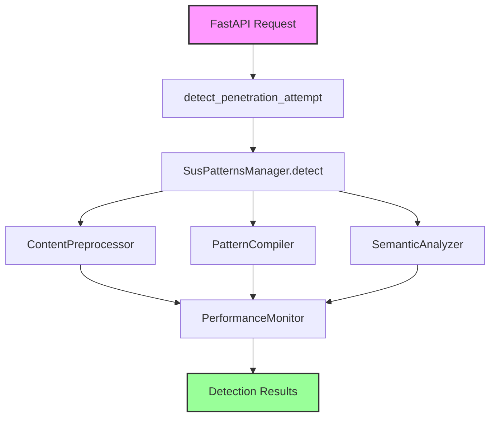

# Detection Engine

The FastAPI Guard Detection Engine is an enhanced pattern-based threat detection system that provides protection against common web application attacks through timeout-protected pattern matching and optional heuristic analysis.

## Overview

The Detection Engine is an evolution of FastAPI Guard's suspicious patterns system, introducing:

- **Timeout Protection**: Prevents ReDoS attacks through configurable execution timeouts
- **Content Preprocessing**: Normalizes, decodes and truncates content while preserving potential attack patterns
- **Semantic Analysis**: Heuristic-based detection for obfuscated attacks (on by default, threshold 0.7)
- **Performance Tracking**: Monitors pattern execution times to identify slow patterns
- **Per-App Pattern Management**: A default pattern manager serves the first app and every app on its Redis prefix, any other app gets a manager of its own

## Key Features

### 1. Pattern Matching with Timeout Protection

The engine protects against Regular Expression Denial of Service (ReDoS) by:

- Wrapping pattern execution in asyncio timeouts
- Configurable timeout via `detection_compiler_timeout` (default: 2.0 seconds)
- Graceful handling of timeout events
- Logging of patterns that exceed timeout thresholds

### 2. Content Preprocessing

The `ContentPreprocessor` component:

- Normalizes Unicode, decodes common encodings, drops null and control characters and collapses whitespace
- Truncates content to `detection_max_content_length` (default: 10,000 characters)
- Preserves attack patterns when `detection_preserve_attack_patterns` is True
- Keeps the regions that `extract_attack_regions()` finds when it truncates
- Returns the processed content (`preprocess_with_decoded()` also returns the decoded content)

### 3. Semantic Analysis

Provides heuristic-based detection:

- Keyword and structure heuristics for the `sql`, `xss`, `command`, `path` and `template` attack families
- Configurable threshold via `detection_semantic_threshold` (default: 0.7, range 0.0 to 1.0); a finding needs a score above it, so 1.0 produces no semantic finding
- Returns probability scores and detected attack types
- Skipped for binary content

### 5. Context-Aware Pattern Filtering

Patterns are tagged with applicable input contexts (e.g., `query_param`, `url_path`, `header`, `request_body`). During detection, only patterns relevant to the current input source are evaluated. This reduces false positives - for example, XSS patterns are not checked against URL paths, and sensitive file probing patterns are not checked against headers.

### 4. Performance Monitoring

Tracks execution metrics:

- Records pattern execution times
- Identifies slow patterns exceeding `detection_slow_pattern_threshold`
- Maintains rolling statistics with configurable history size
- Provides performance summaries and anomaly detection

## Architecture

The Detection Engine uses a modular design:



## Basic Usage

The Detection Engine is automatically used when penetration detection is enabled:

```python
from fastapi import FastAPI
from guard import SecurityMiddleware, SecurityConfig

app = FastAPI()

# Configure with detection engine settings
config = SecurityConfig(
    # Enable penetration detection
    enable_penetration_detection=True,
    # Pattern execution timeout (prevents ReDoS)
    detection_compiler_timeout=2.0,
    # Content preprocessing
    detection_max_content_length=10000,
    detection_preserve_attack_patterns=True,
    # Semantic analysis threshold (a finding needs a score above it)
    detection_semantic_threshold=0.7,
    # Performance monitoring
    detection_slow_pattern_threshold=0.1,
    detection_monitor_history_size=1000,
)

app.add_middleware(SecurityMiddleware, config=config)
```

## How It Works

### 1. Request Analysis

When a request arrives, `detect_penetration_attempt()` extracts content from:

- Query parameters
- Request body (JSON, form data)
- Path parameters
- Headers

### 2. Detection Process

For each content piece, the engine:

```python
# 1. Preprocessing: normalize, decode, drop null bytes, collapse whitespace, then
#    truncate to detection_max_content_length
processed = await preprocessor.preprocess(content)

# 2. Pattern matching with timeout protection: each pattern runs through the
#    PatternCompiler's matchers (detection_compiler_timeout)
for pattern in patterns:
    match = compiler.create_safe_matcher(pattern)(processed)
    if match:
        ...  # Attack detected

# 3. Semantic analysis (skipped for binary content)
analysis = semantic_analyzer.analyze(processed)
score = semantic_analyzer.get_threat_score(analysis)
if score > config.detection_semantic_threshold:
    ...  # Attack detected

# 4. Performance tracking (always enabled)
await performance_monitor.record_metric(
    pattern, execution_time, content_length, matched
)
```

### 3. Results

The engine returns detailed information about detected threats:

```python
{
    "is_threat": True,
    "threat_score": 0.85,
    "threats": [
        {
            "type": "regex",
            "pattern": "union.*select",
            "match": "UNION SELECT",
            "position": 12,
            "execution_time": 0.002,
            "category": "sqli",
            "weight": 1.0,
        }
    ],
    "context": "body:json",
    "original_length": 500,
    "processed_length": 500,
    "execution_time": 0.015,
    "detection_method": "enhanced",
    "timeouts": [],  # List of patterns that timed out
    "correlation_id": "request-123",
}
```

## Configuration Reference

### Detection Settings

| Setting | Type | Default | Description |
|---------|------|---------|-------------|
| `enable_penetration_detection` | bool | `True` | Enable/disable detection engine |
| `detection_compiler_timeout` | float | `2.0` | Maximum seconds for pattern execution |
| `detection_max_content_length` | int | `10000` | Maximum characters to analyze |
| `detection_preserve_attack_patterns` | bool | `True` | Preserve potential attacks during truncation |
| `detection_semantic_threshold` | float | `0.7` | Score the semantic analyzer must exceed for a finding (0.0-1.0, 1.0 gives no finding) |
| `detection_anomaly_threshold` | float | `3.0` | Standard deviations for performance anomaly |
| `detection_slow_pattern_threshold` | float | `0.1` | Seconds to consider pattern slow |
| `detection_monitor_history_size` | int | `1000` | Number of metrics to keep |
| `detection_max_tracked_patterns` | int | `1000` | Maximum patterns to track |

## Component Initialization

The components are built together when the pattern manager is configured with the `SecurityConfig`:

- **PatternCompiler**: Built from `detection_compiler_timeout` and `detection_max_tracked_patterns`
- **ContentPreprocessor**: Built from `detection_max_content_length` and `detection_preserve_attack_patterns`
- **SemanticAnalyzer**: Always created, scored against `detection_semantic_threshold`
- **PerformanceMonitor**: Always created for tracking

## Pattern Management

### Default Patterns

The engine loads patterns from:

1. The built-in pattern table in the package
2. Custom patterns added via API

### Adding Custom Patterns

```python
from guard_core.handlers.suspatterns_handler import sus_patterns_manager_for

# The module-level `sus_patterns_handler` is the default app's manager. Take the
# manager of the app you act on with the config that app was built with.
patterns = sus_patterns_manager_for(security_config)

# Add a pattern
await patterns.add_pattern(r"(?i)malicious_pattern", custom=True)

# Remove a pattern
await patterns.remove_pattern(r"(?i)malicious_pattern", custom=True)

# Clear all custom patterns
for pattern in await patterns.get_custom_patterns():
    await patterns.remove_pattern(pattern, custom=True)
```

## Performance Considerations

### Timeout Protection

The timeout mechanism uses `asyncio.wait_for()` to prevent patterns from running indefinitely:

```python
try:
    result = await asyncio.wait_for(
        pattern_match(content), timeout=config.detection_compiler_timeout
    )
except asyncio.TimeoutError:
    # Pattern timed out, log and continue
    timeouts.append(pattern_string)
```

### Memory Usage

- Content preprocessing limits memory usage by truncating large inputs
- Performance history is bounded by `detection_monitor_history_size`
- Pattern tracking is limited to `detection_max_tracked_patterns`

### CPU Usage

- Timeout protection prevents CPU-intensive patterns from blocking
- Slow patterns are identified and can be optimized or removed
- Semantic analysis is bounded by `detection_max_content_length`

## Integration Points

### Redis Integration

When Redis is enabled:

- Custom patterns can be shared across instances
- Performance metrics can be aggregated
- Pattern effectiveness can be tracked globally

### Agent Integration

When Agent is enabled:

- Detection events are sent with full context
- Performance metrics are reported
- Pattern effectiveness is tracked

## Limitations

1. **Pattern-Based**: The engine relies on regex patterns and heuristics, not true AI/ML
2. **Language Agnostic**: Patterns may not understand context-specific semantics
3. **Performance Trade-offs**: More thorough detection requires more processing time
4. **False Positives**: Legitimate content may trigger patterns

## Best Practices

1. **Start with Defaults**: The default configuration works well for most applications
2. **Monitor Performance**: Use `get_performance_stats()` to identify slow patterns
3. **Adjust Timeouts**: Set timeouts based on your latency requirements
4. **Test Patterns**: Validate custom patterns don't cause false positives
5. **Enable Gradually**: Start with basic detection and enable advanced features as needed

## Troubleshooting

### High False Positive Rate

- Increase `detection_semantic_threshold`
- Review and refine custom patterns
- Consider disabling problematic default patterns

### Performance Issues

- Reduce `detection_max_content_length`
- Increase `detection_compiler_timeout`
- Remove slow patterns identified by monitoring

### Memory Usage

- Decrease `detection_monitor_history_size`
- Reduce `detection_max_tracked_patterns`

## Next Steps

- Review [Detection Engine Components](components.md) for detailed component documentation
- See [Configuration Guide](configuration.md) for advanced configuration
- Check [Performance Tuning](performance-tuning.md) for optimization tips
